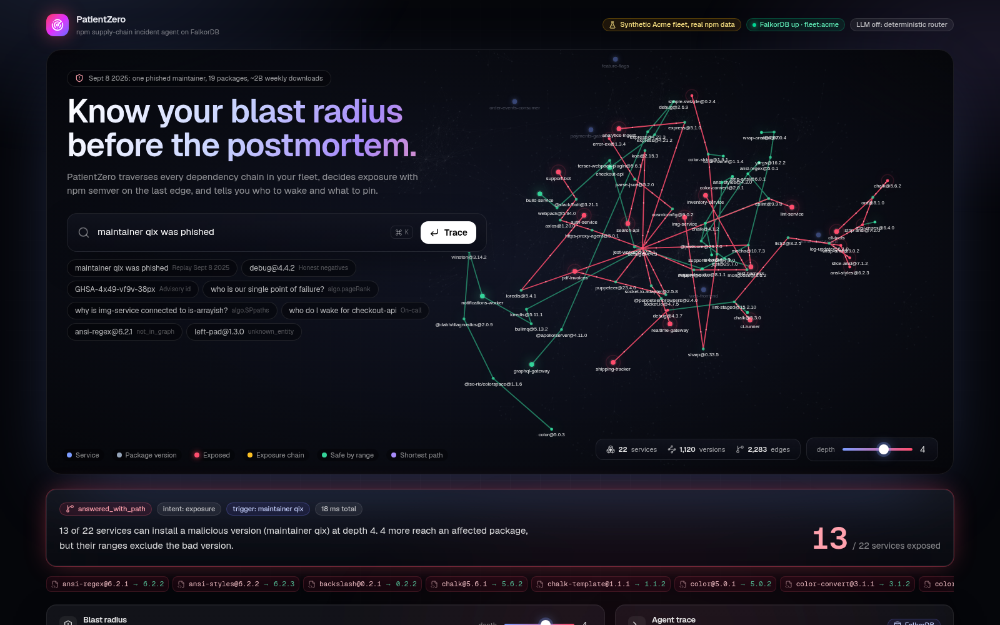
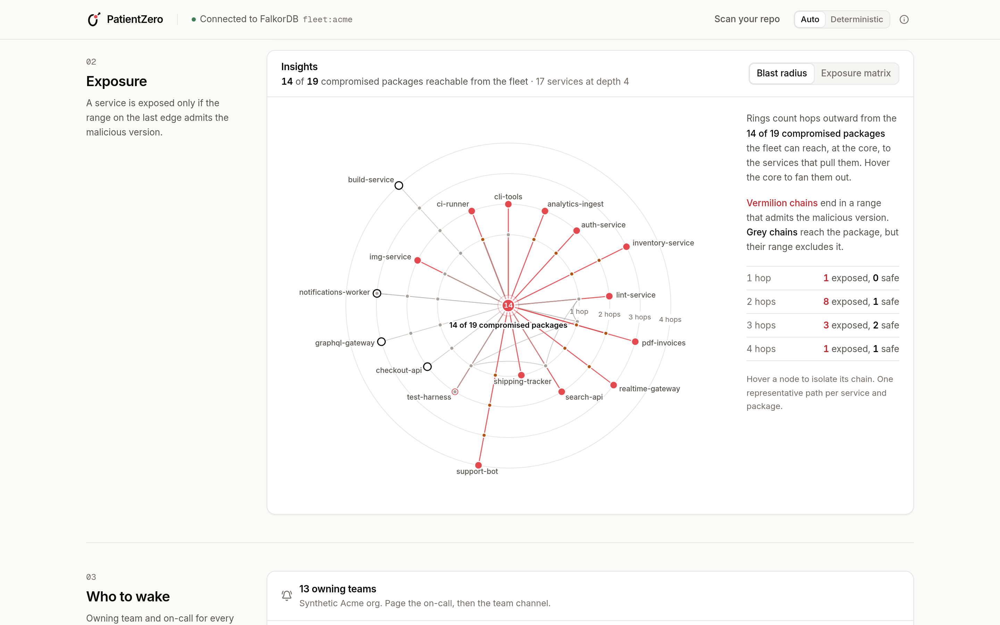
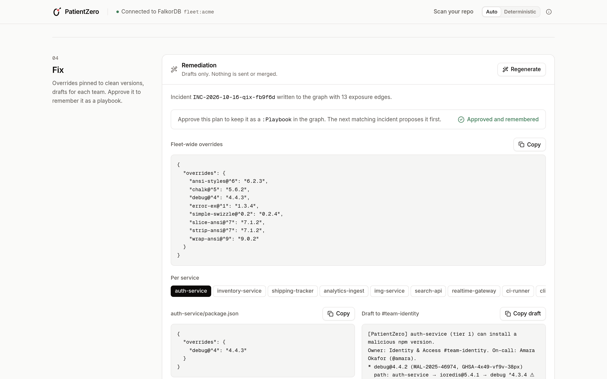
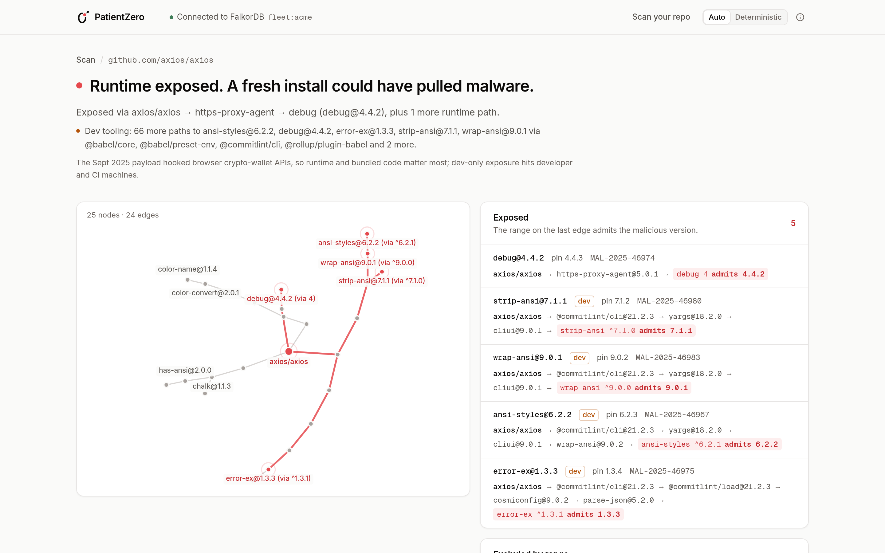

# PatientZero

> When an npm maintainer gets phished, PatientZero tells you in seconds which of your services are hit, the exact dependency chain, who to wake, and the fix. Built on FalkorDB.

- **Live demo:** https://patientzero-production-2cb3.up.railway.app
- **Demo video:** VIDEO_LINK_TBD (added at submission)
- **Tracks:** FalkorDB Hackathon, Track 1 (Agents That Act on Connected Data) and Track 2 (Agent Memory and Coordination); see [Tracks](#tracks)

PatientZero replays the real September 8, 2025 npm compromise (maintainer `qix` phished, 19 malicious versions of
`debug`, `chalk`, `ansi-styles` and friends) against a fleet graph in FalkorDB. Every answer is a Cypher traversal
plus an npm semver check on the last edge, shown with its trace. Nothing is guessed.

| Data | Real or synthetic |
|---|---|
| Malicious versions, advisories (OSV MAL ids, GHSA), clean versions | **Real** (OSV, GitHub advisories, debug-js/debug#1005) |
| Dependency edges and declared ranges | **Real** (deps.dev resolution of real npm versions) |
| npm maintainers | **Real** (registry.npmjs.org) |
| The Acme fleet: 22 services, 8 teams, 16 people, on-call | **Synthetic** (labelled as such in the UI) |
| Bring-your-own repo scans | **Real** (your public GitHub repo or package.json, resolved live via deps.dev) |



| | | |
|---|---|---|
|  |  |  |

More in [docs/screenshots](docs/screenshots).

## Try it yourself
On the [live app](https://patientzero-production-2cb3.up.railway.app), type into the bar (all checked on live, Oct 16, 2026):

| Type | You get |
|---|---|
| `qix` | Answered from graph memory: the approved qix incident, 13 exposed services, patch on file |
| `debug@4.4.2` | 10 of 22 services can install it at depth 4; 4 more reach debug but their ranges exclude it |
| `chalk@5.6.1` | 1 of 22 exposed, 3 excluded by range |
| `GHSA-4x49-vf9v-38px` | The same debug blast radius, entered by advisory id |
| `Shai-Hulud` | Not hit: none of the 22 services can install any of the 589 malicious versions of the 203 worm packages |
| `who to wake for auth-service` | Identity & Access (#team-identity), on-call Amara Okafor |
| `path from img-service to simple-swizzle` | 4 hops: img-service, sharp, color, color-string, simple-swizzle |
| `single points of failure` | npm accounts with the widest fleet reach: qix and matteo.collina (17 services each), sindresorhus (16) |

Then scroll to **Would you have been hit on Sept 8, 2025?** and scan a public repo or a pasted package.json:

| Input | Shows |
|---|---|
| `https://github.com/axios/axios` | Runtime exposed: axios, https-proxy-agent, debug@4.4.2 |
| `https://github.com/sindresorhus/ora` | Runtime exposed: ora, string-width, strip-ansi@7.1.1 |
| `https://github.com/expressjs/express/tree/4.x` (untick devDependencies) | Runtime clean: debug pinned to 2.6.9 exactly |
| `https://github.com/vercel/ms` | Runtime clean; dev tooling only (jest, lint-staged and others reach chalk@5.6.1, debug@4.4.2) |
| package.json `{"dependencies":{"chalk":"^5.3.0"}}` | Runtime exposed: `^5.3.0` admits chalk@5.6.1 |
| package.json `{"dependencies":{"chalk":"5.3.0"}}` | Runtime clean: the exact pin excludes it |

## What you can do
- **Ask** in plain English: "qix was phished, who is affected?", "debug@4.4.2", "GHSA-4x49-vf9v-38px", "who do I wake for checkout-api", "where are our single points of failure?", "why is img-service connected to is-arrayish?", "the guy who maintains chalk got phished".
- **See** the blast radius on the live fleet graph, with exposed chains animated, a depth slider (1 to 6 hops) and honest negatives ("checkout-api reaches debug through express@4.21.2, but the exact pin 2.6.9 excludes 4.4.2").
- **Insights**, all derived from the returned graph paths:
  - *Blast radius rings*: compromised package in the center, one ring per hop out to the services.
  - *Exposure matrix*: services x compromised packages, shaded by the number of admitting paths.
  - *Reach vs PageRank*: maintainer single points of failure (fleet reach from Cypher, `algo.pageRank` over the dependency graph).
  - *Incident timeline*: every dated event in the graph, from the compromise and OSV advisories to incidents and approved playbooks.
- **Fix**: an install-safe package.json patch per service, Slack drafts per owning team, written back to the graph as an `(:Incident)`. Direct dependencies are bumped in `dependencies` (a plain override on a direct dependency fails with npm `EOVERRIDE`); transitive packages get an override scoped to the compromised major, for example `"ansi-styles@^6": "6.2.3"`, so chalk 4 keeps ansi-styles 4 and express 4 keeps debug 2. Verified with real `npm install` (npm 10, Node 20): [docs/verification/npm-patches.txt](docs/verification/npm-patches.txt), reproduce with `cd backend && uv run python ../scripts/verify_npm_patches.py`.
- **Remember**: every incident question is answered by a fresh traversal, with the remembered incident shown next to it ("Seen before: INC-... on Oct 16, 13 services, patch on file", plus what changed since). A bare recall such as `qix` in a new session answers straight from graph memory. **Approve** a fix and it becomes a `(:Playbook)` that later incidents on the same packages reuse.
- **Bring your own repo**: "Would you have been hit on Sept 8, 2025?" Paste a GitHub URL or package.json. Try `github.com/axios/axios` (exposed through `https-proxy-agent` then `debug`) and `github.com/expressjs/express/tree/4.x` with runtime deps only (clean).
- **Second incident, the Shai-Hulud worm (Sept 15, 2025)**: 203 OSV malicious-package advisories (589 versions), loaded on the live deploy. Ask "were we hit by the Shai-Hulud worm?". The honest answer for the Acme fleet is "Not hit": no service depends on any of those packages. Locally, enable it with `INCIDENTS=qix,shai-hulud` (on an existing graph, `python ingest/seed_if_missing.py` adds it with MERGE only, so memory is kept). Bring-your-own scans check the qix incident only.

- **Run the incident crew**: four deterministic agents (Triage, Investigator, Responder, Fixer; no LLM, reproducible, a run takes well under a second) work the incident over shared graph state: one lane per agent over SSE, the reads and handoffs drawn as a DAG, and a summary with who to page, page drafts (never sent), the patch plan and the playbook. Every run is replayable from the graph with a shareable `?run=` URL.
- **Switch tenants**: Acme (22 services) and Globex (12 services) are separate FalkorDB graphs with separate memory. Shai-Hulud: Acme is not hit, Globex has 4 of 12 services exposed.
- **Ask follow-ups**: "who should I wake for that?", "and at depth 6?". The session lives in the graph and the history rail shows every turn and what it resolved to.
- **Watch live npm malware**: every 10 minutes the OSV watch checks new `MAL-*` advisories against both fleets and shows a per-tenant verdict on the timeline ("not hit: 25 new advisories checked"). A labelled replay runs the real `debug@4.4.2` advisory through the same pipeline. If every version of a package is malicious, the answer says so up front.
- **See the MCP call**: every trace shows the agent's MCP `tools/call` (tool, arguments, latency). In deterministic mode it is the first step; in LLM mode it follows the model's tool choice.
- **Benchmark view**: the latest concurrency run (throughput, p50/p95/p99, errors), labelled with where it ran.

## Agent design
- A **deterministic intent router** picks among 8 tools, each backed by parameterised Cypher in `queries/*.cypher`. It is the default path, the fallback and the test oracle.
- **Tool selection through MCP.** The agent is an MCP client of PatientZero's own MCP server (the same server Claude Desktop or Cursor use), over the official `mcp` SDK's in-memory transport: it lists the tools (`tools/list`) and runs the chosen one with `tools/call`. The deterministic router's graph tools run as MCP `tools/call`s (the trace names each one); in LLM mode the model itself selects among the MCP tools listed by `tools/list` (write tools such as `remediation_plan` and `crew_run` are never offered). The trace shows each MCP call (`via: mcp`, tool, arguments, latency): first in deterministic mode, after the model's choice in LLM mode; if MCP itself fails the agent calls the same function directly and the trace says `via: direct`. Cost: about 4 ms per question. `MCP_AGENT=off` disables it.
- With `OPENAI_API_KEY` set, the **LLM is used only when the router is not confident** (or the user picks LLM mode). It can only call the same tools; it never writes Cypher. Plain-English phrasings of the loaded incident ("that npm phishing attack last September", "the guy who maintains chalk got phished") are mapped to maintainer `qix` by router synonyms first, so they never need the LLM.
- **Name check on every LLM answer**: any service, package, person or @handle in the model's sentence that is not in the tool result (including names the graph has never heard of, like an invented service) is flagged. If anything is flagged, the model's sentence is dropped, the templated deterministic answer is shown instead, and the trace says "LLM answer rejected".
- The **AI incident summary** runs only when the user clicks for it, and is withheld under the same rule.
- **Cost controls**: `OPENAI_MODEL` (default gpt-4o-mini), max tokens 400 (tools) and 250 (summary), compact tool schemas and a trimmed tool-result digest (a question costs about 1.2k to 1.7k tokens, usually one call, because the router pre-runs `investigate`), answer cache per (question, graph), a server-side daily call cap (`OPENAI_DAILY_CALL_CAP`, default 200) and a per-client limit (`OPENAI_PER_IP_PER_MIN`, default 10). Over a limit, the answer comes from the deterministic router with a visible note in the trace. Token usage is logged to `.cache/llm_usage.jsonl`. The trace always shows whether the LLM was used and its token count. Tests never call the API.

## Stack
- **Graph DB:** FalkorDB 6.0.1, as a Redis module (`falkordb.so` in `redis-server`, no Docker needed locally) or FalkorDB Cloud (`FALKORDB_URL`)
- **Backend:** Python 3.13, FastAPI, `falkordb` client, `uv` (`backend/`); MCP server with the same tools
- **Frontend:** Next.js 15, TypeScript, Tailwind v4, framer-motion, react-force-graph-2d (`frontend/`)

## Prerequisites
- Linux x86_64 with `redis-server` 7+ (`sudo apt-get install -y redis-server libgomp1`), or Docker for the production image
- Python 3.13 + [uv](https://docs.astral.sh/uv/), Node 20+

## Setup and run (local)
```bash
cp .env.example .env                 # defaults work locally; OPENAI_API_KEY is optional
./scripts/start-falkordb.sh          # downloads falkordb.so (v6.0.1) on first run, starts redis-server on :6379 (AOF on)
python3 -m venv ingest/.venv && ingest/.venv/bin/pip install -r ingest/requirements.txt
ingest/.venv/bin/python ingest/load.py          # builds graph fleet:acme from data/ (under 1 s, idempotent)
TENANT=globex ingest/.venv/bin/python ingest/load.py   # second tenant: graph fleet:globex (Globex, hit by Shai-Hulud)
(cd backend && uv sync)
(cd frontend && npm install)
./scripts/dev.sh                     # backend :8000, frontend http://localhost:3001
```

Single-origin production build (what the Dockerfile and Railway run): see [DEPLOY.md](DEPLOY.md).

## Tests
```bash
cd backend && uv run pytest -q                                              # unit + integration (needs FalkorDB with fleet:acme)
ingest/.venv/bin/python ingest/verify.py                                   # data-level acceptance checks
NODE_PATH=/path/to/node_modules node scripts/e2e_screenshots.cjs           # 17 browser checks, screenshots in docs/screenshots
NODE_PATH=/path/to/node_modules node scripts/e2e_crew_tenants.cjs          # 25 checks: tenants, crew, follow-ups, watch, MCP, bench
python scripts/stress_streams.py --base http://127.0.0.1:8000 --seconds 120  # SSE + crew + ask load; fails if /health stalls
```
The backend suite (198 tests) passes on FalkorDB 6.0.1 and on 4.22.1 (the live version); both browser suites pass
locally and against the live deploy. Security audit: [docs/verification/security.md](docs/verification/security.md).

## API
| Method | Path | Description |
|---|---|---|
| GET | `/health` | FalkorDB status, graph, agent mode, LLM model, tools, LLM budget |
| POST | `/api/ask` | `{query, depth?, fresh?, session_id?, tenant?, mode?}`: the agent. Returns outcome, message, paths, graph, wake, trace; with `session_id`, follow-ups ("who should I wake for that?", "and at depth 6?") resolve from the history stored in the graph |
| POST | `/api/fix` | Same, plus remediation plan written to the graph as an Incident |
| POST | `/api/summary` | Optional one-paragraph AI summary, name-checked |
| GET | `/api/fleet`, `/api/fleet/graph` | Fleet services and the full graph for the hero view |
| GET | `/api/incidents` | Incidents in graph memory |
| GET | `/api/timeline` | Dated events: compromise, advisories, incidents, playbooks |
| POST | `/api/memory/reset` | Clear incidents (admin) |
| POST | `/api/admin/reset` | Demo reset for one tenant: incidents, findings, crew runs, sessions, playbooks. BYO scan graphs are kept unless `?include_byo=true` (admin) |
| GET | `/api/tools`, POST `/api/tools/{name}` | The tool catalogue, callable directly |
| POST | `/api/byo/scan` | `{github_url \| package_json, include_dev?, depth?}`: scan your repo in an isolated graph |
| POST | `/api/incidents/{id}/approve`, GET `/api/playbooks` | Approve-then-remember (DELETE `/api/playbooks` is admin) |
| POST | `/api/byo/cleanup` | Delete expired BYO scan graphs (admin) |
| POST | `/api/crew/run` | `{query, depth?, session_id?, tenant?}`: four agents (Triage, Investigator, Responder, Fixer) hand off through FalkorDB; streams SSE (`run`, `agent_start`, `read`, `finding`, `handoff`, `agent_done`, `done`), or JSON with `?stream=false`. 6 per IP per minute |
| GET | `/api/crew/{run_id}`, `/api/crew` | Replay a crew run from the graph; recent runs |
| GET | `/api/sessions/{id}` | Conversation history (turns and the graph nodes each was ABOUT) |
| GET | `/api/tenants` | Tenants, each a separate FalkorDB graph. Every endpoint takes `?tenant=` or `X-Tenant` (default acme) |
| GET | `/api/watch/feed`, `/api/watch/stream` | Live OSV npm malware watch: recent checks with verdicts per tenant; SSE stream of new checks and polls |
| POST | `/api/watch/replay` | `{advisory}`: re-play a past real advisory (default `debug@4.4.2`) through the watcher, labelled as a replay |
| POST | `/api/watch/poll` | Poll OSV now (admin); the background poll runs every 10 min |
| GET | `/api/bench/last`, POST `/api/bench/run` | Latest concurrency benchmark; start a bounded server-side run (admin) |

Admin endpoints need the `X-Admin-Token` header when `ADMIN_TOKEN` is set (always on the public deploy):
`curl -XPOST "$URL/api/admin/reset?tenant=acme" -H "X-Admin-Token: $ADMIN_TOKEN"` (one tenant per call). Locally, with
`ADMIN_TOKEN` empty, they are open. Full request, response and SSE shapes for the crew, sessions and tenants:
[docs/CONTRACT-crew-sessions-tenants.md](docs/CONTRACT-crew-sessions-tenants.md).

## MCP server (Claude Desktop, Cursor)
The same 8 tools over stdio, plus `investigate`, `crew_run`, `session_history` and `list_tenants`. Add to `claude_desktop_config.json` or `.cursor/mcp.json`:
```json
{
  "mcpServers": {
    "patientzero": {
      "command": "uv",
      "args": ["--directory", "/absolute/path/to/repo/backend", "run", "python", "-m", "app.mcp_server"],
      "env": { "FALKORDB_HOST": "localhost", "FALKORDB_PORT": "6379", "FALKORDB_GRAPH": "fleet:acme" }
    }
  }
}
```

## Graph data model
One graph per tenant: `fleet:acme` for the demo fleet, and an isolated `byo:<hash>` graph per bring-your-own scan
(FalkorDB multi-graph, same schema). Full details, sources and the exposure rule: [ingest/README.md](ingest/README.md).

| Node | Key properties | Source |
|---|---|---|
| `Team` | name, display, slack, pager | synthetic |
| `Person` | name, handle, role | synthetic |
| `Service` | name, tier, env, runtime, repo | synthetic (deps are real npm) |
| `Package` | name | npm registry |
| `Version` | key `pkg@ver`, pkg, version, unpublished, malicious | deps.dev, npm |
| `Advisory` | id (OSV MAL id), ids, aliases (GHSA, CVE), bad_version, fixed_version, campaign | OSV, GitHub advisories |
| `Maintainer` | npm | npm registry, curated incident data |
| `Incident`, `Finding` | id, at, trigger, entity_key, depth, exposed_count, patch | written by the agent (memory) |
| `Playbook` | id, approved_at, approved_by, overrides, steps | written when a human approves a fix |

| Relationship | Meaning |
|---|---|
| `(:Team)-[:OWNS]->(:Service)` | ownership |
| `(:Person)-[:MEMBER_OF]->(:Team)`, `(:Person)-[:ONCALL_FOR]->(:Team)` | who to wake |
| `(:Service)-[:DEPENDS_ON {requirement}]->(:Version)` | direct dependency, declared range kept |
| `(:Version)-[:REQUIRES {requirement}]->(:Version)` | resolved transitive edge, declared range kept |
| `(:Package)-[:HAS_VERSION]->(:Version)` | versions of a package |
| `(:Advisory)-[:AFFECTS]->(:Version {malicious:true})` | malicious (unpublished) versions |
| `(:Maintainer)-[:MAINTAINS]->(:Package)` | today's maintainers |
| `(:Maintainer {npm:'qix'})-[:HAD_PUBLISH_RIGHTS {asOf}]->(:Package)` | curated, 19 edges |
| `(:Incident)-[:ABOUT]->(...)`, `-[:EXPOSED {path}]->(:Service)`, `-[:HAS_FINDING]->(:Finding)` | episodic memory |
| `(:Playbook)-[:APPROVED_FROM]->(:Incident)`, `-[:COVERS {pin}]->(:Package)`, `-[:MITIGATES]->(:Advisory)`, `(:Incident)-[:APPLIED_PLAYBOOK]->(:Playbook)` | procedural memory |

**Exposure rule.** The malicious versions were unpublished within hours, so they never appear in today's resolved
trees. A path is exposed when the semver range on its last edge admits the malicious version (what a fresh install
on Sept 8, 2025 would have resolved). FalkorDB returns the candidate paths; npm semver runs in the app.

## Cypher queries and algorithms
Every tool runs parameterised Cypher from [`queries/`](queries/). No Cypher is ever generated from
user text or by the LLM. Each file marks its statements with `// @query <name>`.

| File | Queries | What it does |
|---|---|---|
| [resolve_entity.cypher](queries/resolve_entity.cypher) | `resolve_entity` | Maps free text (maintainer, advisory id or alias, pkg@ver, service, package) to graph nodes before any traversal |
| [incident_scope.cypher](queries/incident_scope.cypher) | `incident_scope_by_maintainer`, `_by_advisory`, `_by_version`, `_by_campaign` | The malicious versions in scope, with advisory ids and clean versions |
| [incident_scope_by_package.cypher](queries/incident_scope_by_package.cypher) | `incident_scope_by_packages` | Same, for bare package names ("chalk and debug were compromised") |
| [exposure.cypher](queries/exposure.cypher) | `exposure` | **Variable-length traversal** `(:Service)-[:DEPENDS_ON\|REQUIRES*1..6]->(:Version)` to every version of the affected packages, filtered by `length(p) <= $depth`, returning the path and the requirement on every hop |
| [path_between.cypher](queries/path_between.cypher) | `path_between`, `path_between_shortestpath` | "Why is img-service connected to is-arrayish?": **`algo.SPpaths`** shortest weighted path over DEPENDS_ON/REQUIRES, with `shortestPath()` as fallback |
| [single_points_of_failure.cypher](queries/single_points_of_failure.cypher) | `single_points_of_failure`, `package_reach`, `top_packages_pagerank` | Which maintainer, if phished, reaches the most services (reach over `*1..6`), tie-broken by **`algo.pageRank('Version','REQUIRES')`** |
| [who_to_wake.cypher](queries/who_to_wake.cypher) | `who_to_wake` | Owning team, Slack, pager, on-call and members per service |
| [package_maintainers.cypher](queries/package_maintainers.cypher) | `package_maintainers` | Today's npm maintainers plus curated historical publish rights for a package |
| [remediation_plan.cypher](queries/remediation_plan.cypher) | `create_incident`, `link_incident_entity`, `link_exposed`, `add_findings` | Writes the incident, one EXPOSED edge per exposed service and per-service findings (memory) |
| [recall.cypher](queries/recall.cypher) | `recall` | Prior incidents about an entity, directly or through the maintainer's publish rights; shown as "Seen before" |
| [incident_memory.cypher](queries/incident_memory.cypher) | `list_incidents`, `incident_exposed_count`, `reset_memory` | Memory panel, AC9 edge check, admin reset |
| [playbook.cypher](queries/playbook.cypher) | `playbook_create`, `playbook_match`, `playbook_apply`, ... | Approve-then-remember: stores an approved fix as a Playbook and finds it by traversal for later incidents |
| [timeline.cypher](queries/timeline.cypher) | `timeline_events` | Every dated event: compromise, advisories, incidents, playbooks |
| [fleet_overview.cypher](queries/fleet_overview.cypher) | `fleet_overview`, `graph_stats` | Home screen fleet list and counts |
| [fleet_graph.cypher](queries/fleet_graph.cypher) | `fleet_graph_nodes`, `fleet_graph_edges` | The whole fleet dependency graph for the hero visualization |
| [byo.cypher](queries/byo.cypher) | `byo_create_*`, `byo_export_incident`, ... | Builds an isolated `byo:<hash>` graph per scanned repo; the unchanged `exposure` query then runs on it |

FalkorDB features used: multi-graph tenancy, variable-length paths, `algo.SPpaths`, `algo.pageRank`,
`shortestPath()`, pattern comprehensions, `UNWIND` batch writes, indexes on every lookup key, and parameterised
`ro_query` for every read.

**Hardened against a known FalkorDB 6.x crash.** On 6.0.x, a `RETURN` that mixes an aggregate with a null
column can panic the server ([FalkorDB#3150](https://github.com/FalkorDB/FalkorDB/issues/3150), fix pending in
#3229). We hit it during testing, so every affected query now aggregates in `WITH` and only projects in `RETURN`,
Team fields get defaults at load time, and
[`tests/test_query_safety.py`](backend/tests/test_query_safety.py) fails the build if that query shape comes
back. The suite passes on both 6.0.1 and 4.22.1 (the version live runs).

## Tracks
Each focus point of both tracks, the feature that covers it, and where it lives.

**Track 1: Agents That Act on Connected Data**

| Focus point | Feature | Files |
|---|---|---|
| Reason over connected data with multi-hop traversals | Exposure: service to compromised version over `DEPENDS_ON`/`REQUIRES` up to 6 hops, then npm semver on the last edge; honest negatives; `path_between`, blast radius rings | `queries/exposure.cypher`, `queries/incident_scope.cypher`, `queries/path_between.cypher`, `backend/app/tools.py`, `backend/app/router.py` |
| Graph algorithms | Maintainer single points of failure with `algo.pageRank` plus fleet reach | `queries/single_points_of_failure.cypher` |
| Tool use, with tool selection through MCP | The agent lists and calls its tools over its own MCP server (official SDK, in-memory transport). In deterministic mode the router's tool calls go over MCP; in LLM mode the model picks among the listed MCP tools. Direct fallback is flagged | `backend/app/mcp_agent/`, `backend/app/mcp_server.py` |
| Grounded LLM use | The router first; the LLM only picks tools, never writes Cypher; answers naming anything not in the tool result are rejected | `backend/app/core/agent.py` |
| Acting: decide and write back | Who to wake, an install-safe package.json patch per service (verified with real `npm install`), Slack drafts, `(:Incident)` written to the graph | `queries/who_to_wake.cypher`, `queries/remediation_plan.cypher`, `backend/app/tools.py`, `docs/verification/npm-patches.txt` |
| Acting on live, real-world data | OSV npm malware watch every 10 minutes into every tenant graph, with a per-tenant verdict, SSE feed, timeline `watch` events and a labelled replay | `backend/app/watch/`, `queries/watch.cypher`, `docs/CONTRACT-watch-mcp-bench.md` |
| Your own data | Bring-your-own repo scan (public GitHub repo or package.json via deps.dev) into its own graph | `backend/app/byo/` |

**Track 2: Agent Memory and Coordination**

| Focus point | Feature | Files |
|---|---|---|
| Shared state and handoffs between agents | The incident crew: Triage, Investigator, Responder, Fixer write `(:AgentRun)-[:PRODUCED]->(:Finding)` and `HANDED_OFF_TO {reason}`; each agent reads upstream findings back from FalkorDB; Investigator and Responder run concurrently (a real DAG); replay from the graph | `backend/app/crew/`, `queries/crew.cypher`, `docs/CONTRACT-crew-sessions-tenants.md` |
| Episodic memory that updates over time | `Incident` nodes recalled as "Seen before"; a re-triage updates `last_seen`, `triage_count` and a what-changed delta | `queries/incident_memory.cypher`, `queries/recall.cypher`, `backend/app/router.py` |
| Procedural memory | Approve a fix once and it becomes a `Playbook` that later incidents find by traversal, with `uses_count` and `last_used`; the Fixer prefers the most reused one | `backend/app/playbooks.py`, `queries/playbook.cypher` |
| Persistent conversation history | `(:Session)-[:HAS_TURN]->(:Turn)-[:ABOUT]->(node)`; follow-ups resolve "that" from the last turn in the graph | `backend/app/sessions.py`, `queries/sessions.cypher` |
| Separate memory per tenant | Acme and Globex are separate graphs (multigraph); nothing approved in Acme is recalled in Globex | `backend/app/tenants.py` |
| High-concurrency reads and writes | 20 concurrent crews in a test with exact counts; in-process database benchmark through `/api/bench/run` on the deployed FalkorDB 4.22.1: 30 clients for 20 s with 20% synthetic writes into a scratch graph (deleted afterwards) and retry on busy, **740.6 ops/s, p50 36 ms, p95 84 ms, p99 112 ms, 0 errors** (14,813 ops; reads 593/s, writes 147/s). This is not end-to-end HTTP throughput: through the public API it is about 50 req/s at 30 clients. Local in-process: 64 clients 2,292 ops/s (p99 70 ms). Full numbers: [docs/verification/concurrency.md](docs/verification/concurrency.md) | `backend/app/bench/`, `scripts/bench_concurrency.py`, `backend/tests/test_crew_sessions_tenants.py` |
| Staying up under load | The crew never blocks the event loop; capped crew runs and SSE streams (global and per IP); bounded DB pool; stress test | `backend/app/streamguard.py`, `scripts/stress_streams.py`, `docs/verification/security.md` |

## Demo script
See [docs/DEMO.md](docs/DEMO.md).

## AI assistance disclosure
- **Building:** this project was built with AI coding assistants (Grok Bot agents for research, spec, code, tests
  and review). Every Cypher query in `queries/` is parameterised and was written for this project, never generated from user text; all
  acceptance checks are reproducible with the test commands above.
- **At runtime:** the product works fully without any LLM. With `OPENAI_API_KEY` set, OpenAI `gpt-4o-mini` (via
  `OPENAI_MODEL`) is used only to pick among the fixed tools when the deterministic router is not confident,
  to phrase answers, and for the optional click-to-run summary. It never writes Cypher, every name it outputs is
  checked against the tool result, and spend is capped server side.
